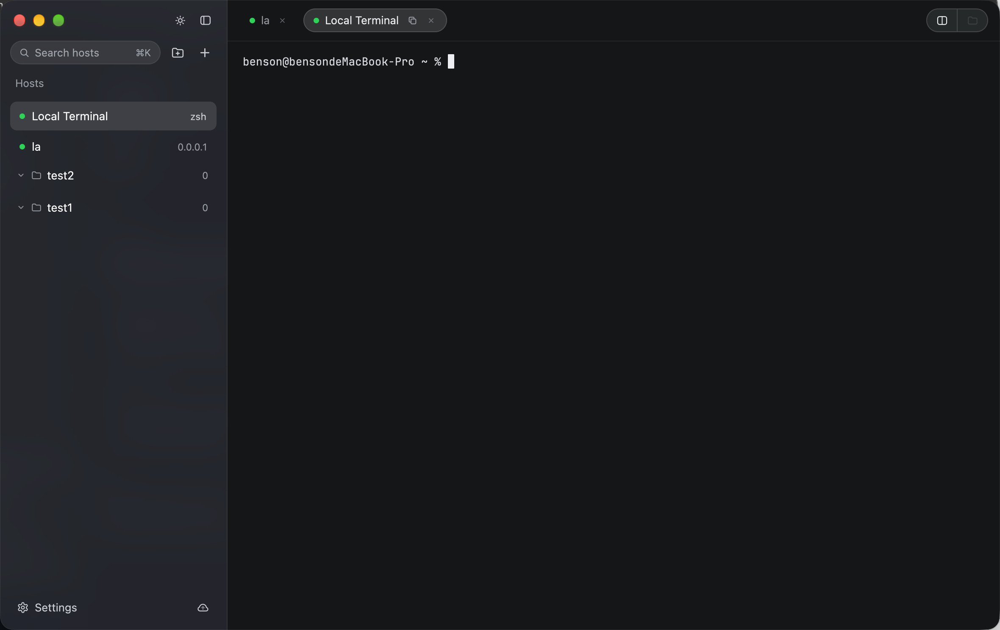
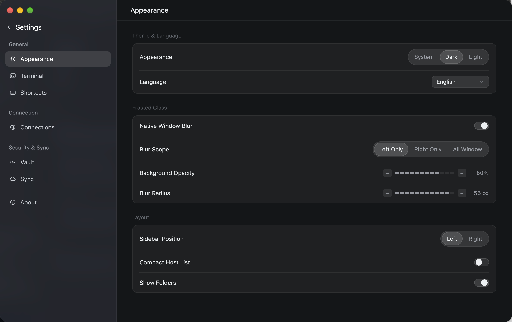
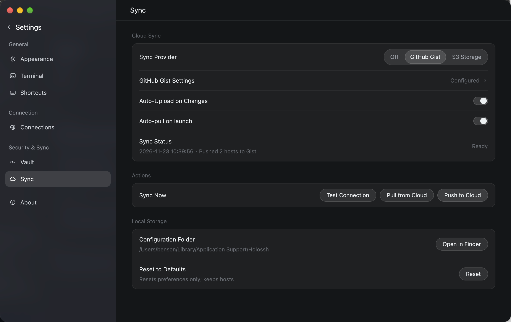

# Holossh

[简体中文](./README.md) | [繁體中文](./README.zh-TW.md) | **English** | [日本語](./README.ja.md) | [한국어](./README.ko.md)

**A refined, high-performance SSH client with cross-device encrypted sync.**

Holossh is a native SSH and local terminal client crafted for macOS and built with GPUI. It pairs a restrained frosted-glass aesthetic with smooth GPU-accelerated terminal rendering, built-in SFTP file management, and end-to-end encrypted multi-device sync.



| Appearance & Frosted Glass | End-to-End Cloud Sync |
| :---: | :---: |
|  |  |

---

## Key Features

### Native Frosted-Glass Design & Localization
- **Dark, Light & System Appearance**: Defaults to Dark Mode with seamless Light Mode and System appearance support, automatically adapting window materials and the app icon.
- **Customizable Glass Material**: Tune blur scope (sidebar-only or full-window translucency), terminal opacity, and Gaussian blur intensity. Move the sidebar left or right and drag to resize.
- **Multi-Language UI**: Built-in support for Simplified Chinese, Traditional Chinese, English, Japanese, and Korean, following your system language by default.

### High-Performance Terminal & Multi-Pane Workspace
- **Smooth Rendering Under Heavy Load**: Built for high-throughput logs and responsive scrolling, with live font zoom, configurable scrollback history, and one-click programming font downloads.
- **Tabs & Flexible Split Panes**: Organize sessions across tabs and split horizontally or vertically at any depth. Inactive tabs show a subtle unread indicator when a terminal bell fires.
- **Thoughtful Workflow Details**:
  - Instant in-terminal search with live match highlighting;
  - `⌘ + Click` to open URLs directly from terminal output;
  - Drag local files into a remote terminal to upload directly to the current directory (hold `⌥` or drop into a local terminal to paste shell-escaped paths);
  - Multi-line paste confirmation to prevent accidental command execution;
  - Automatic reconnection after transient network drops or system sleep.

### Versatile Connections & Local Terminal
- **Local Terminal**: Select **Local Terminal** when adding a host to save immediately without filling in any address or credentials—launches your default local shell directly without needing Remote Login (`sshd`).
- **Flexible Networking**: Direct connections, multi-hop Jump Hosts (reusing saved hosts), SOCKS5 proxy, and HTTP proxy.
- **Complete Authentication**: Auto, Password, Private Key (including passphrase-protected keys), SSH Agent, and Keyboard-Interactive (2FA / OTP), plus interactive host key fingerprint verification and change warnings.
- **Read-Only `~/.ssh/config` Import**: Import existing SSH hosts with one click while never modifying your original config file.

### Built-In SFTP File Panel
- Toggle a sleek SFTP drawer beside any active SSH session to browse remote directories, create folders, delete items, and upload or download files with live transfer progress and cancellation.

### End-to-End Encrypted Vault & Cloud Sync
- **Local Encrypted Vault**: Passwords and private keys are encrypted locally with your master password and never written in plaintext. Configure unlock persistence to fit your workflow (every time, until quit, or remember for 1 / 3 / 7 days).
- **Zero-Knowledge Cloud Sync**: Sync hosts, groups, settings, and vault across devices using your own **GitHub Gist** or any **S3-compatible object storage** (AWS S3, Cloudflare R2, MinIO, etc.). Everything is encrypted locally before upload.
- **Local Backup**: Export and import configuration backups anytime.

### Fully Customizable Shortcuts
- Click any shortcut in **Settings → Shortcuts** to record a new key combination with automatic conflict detection, instant sync across the app and macOS menu bar, and one-click reset to defaults.

---

## Default Shortcuts

> Every shortcut can be customized in **Settings → Shortcuts**.

| Action | Default Shortcut |
| --- | --- |
| Search Hosts | `⌘K` |
| Open / Close Settings | `⌘,` |
| New Host | `⌘N` |
| New Tab | `⌘T` |
| Close Current Pane / Tab | `⌘W` |
| Find in Terminal | `⌘F` |
| Split Right | `⌘D` |
| Split Down | `⇧⌘D` |
| Toggle SFTP Panel | `⌘E` |
| Toggle Sidebar | `⌘B` |
| Zoom In / Out / Reset Font | `⌘+` / `⌘-` / `⌘0` |
| Copy / Paste | `⌘C` / `⌘V` |

---

## Building from Source

### Requirements
- **OS**: macOS
- **Toolchain**: Rust 1.85 or later (install via [rustup.rs](https://rustup.rs/))

### Build & Run

```bash
# Clone the repository
git clone https://github.com/Fokkyp/Holossh.git
cd holossh

# Build and run the release binary
cargo run --release
```

---

## Privacy & Security

- **No Plaintext Credentials**: Passwords and key passphrases are stored exclusively inside the encrypted local vault.
- **Read-Only SSH Config Import**: Importing `~/.ssh/config` is strictly read-only and never alters your original file.
- **End-to-End Encrypted Sync**: Cloud sync encrypts all data locally before uploading to your own GitHub Gist or S3 bucket—no third-party relay servers involved.

---

## License

This project is licensed under the [GNU General Public License v3.0 (GPL-3.0)](./LICENSE).
