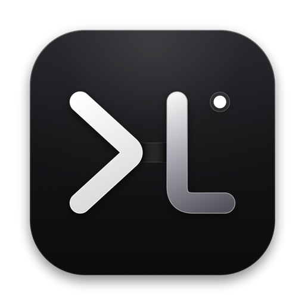
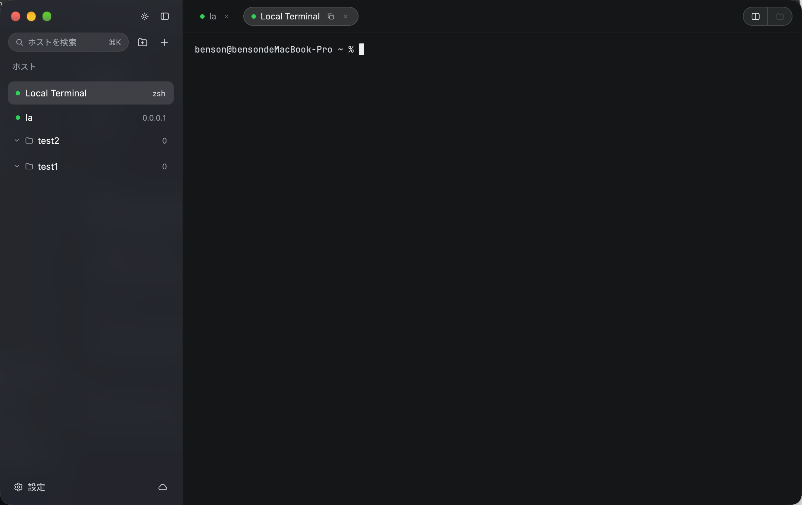
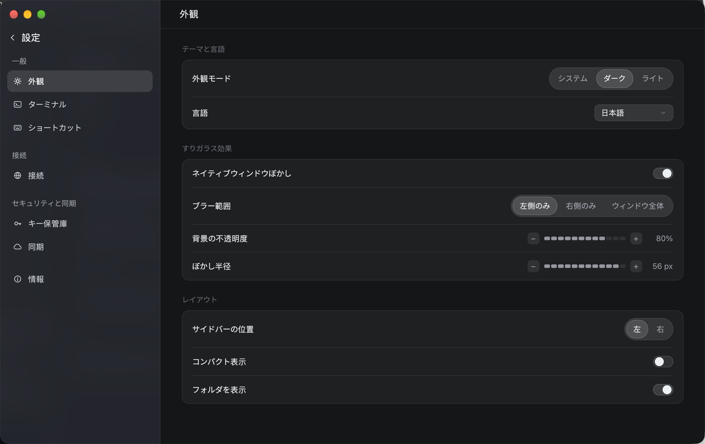
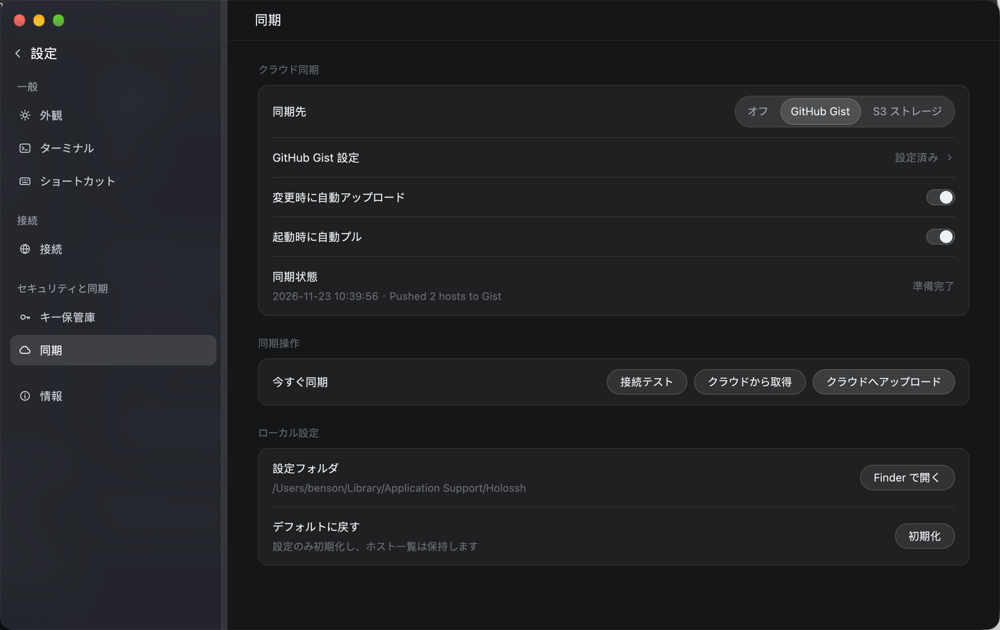

<div align="center">
  <picture>
    <source media="(prefers-color-scheme: dark)" srcset="./assets/app-icon/AppIcon-Dark.png" />
    <source media="(prefers-color-scheme: light)" srcset="./assets/app-icon/AppIcon-Light.png" />
    
  </picture>

  <h1>Holossh</h1>

  <p><strong>美しく、クロスプラットフォーム同期に対応した高性能 SSH クライアント。</strong></p>

  <p>
    <a href="./README.md">简体中文</a> ·
    <a href="./README.zh-TW.md">繁體中文</a> ·
    <a href="./README.en.md">English</a> ·
    <strong>日本語</strong> ·
    <a href="./README.ko.md">한국어</a>
  </p>

  <p>
    <a href="https://github.com/Fokkyp/Holossh/releases/latest"><strong>最新バージョンをダウンロード（macOS）</strong></a>
  </p>
</div>

Holossh は macOS 向けに設計され、GPUI で構築されたネイティブ SSH・ローカルターミナルクライアントです。透明感のあるすりガラスデザイン、軽快な GPU アクセラレーション描画、内蔵 SFTP ファイル管理、そしてエンドツーエンド暗号化によるマルチデバイス同期を備えています。



| 外観とすりガラス質感 | エンドツーエンド同期 |
| :---: | :---: |
|  |  |

---

## 主な機能

### ネイティブすりガラスデザインと多言語対応
- **ダーク／ライト／システム連動**：デフォルトはダークモード。ライトモードやシステム外観への追従に対応し、ウィンドウ質感やアプリアイコンも連動します。
- **質感のカスタマイズ**：すりガラスの適用範囲（サイドバーのみ／ウィンドウ全体）、ターミナルの不透明度、ぼかし強度を自由に調整可能。サイドバーの左右切替や幅調整にも対応しています。
- **多言語 UI**：簡体字中国語・繁体字中国語・English・日本語・韓国語を内蔵し、初回起動時はシステム言語に自動追従します。

### 高性能ターミナルとマルチペイン作業空間
- **高負荷でも滑らかな描画**：大量のログ出力でも軽快にスクロール・入力でき、フォントサイズ拡大縮小、スクロールバック履歴設定、主要プログラミングフォントのワンクリック導入に対応しています。
- **タブと自在な画面分割**：複数タブと左右・上下の自由なペイン分割に対応。非アクティブなタブでベル通知が発生すると控えめなインジケーターで知らせます。
- **快適な操作性**：
  - ターミナル内のリアルタイム検索・ハイライト表示；
  - `⌘ + クリック` でターミナル上の URL を直接オープン；
  - リモートターミナルへのファイルドロップで現在のディレクトリへ即アップロード（`⌥` を押しながら、またはローカルターミナルへのドロップではエスケープ済みパスを貼り付け）；
  - 複数行コマンド貼り付け時の誤実行防止確認；
  - ネットワーク切断やスリープ復帰後の自動再接続。

### 多彩な接続方式とローカルターミナル
- **ローカルターミナル**：ホスト追加時に「ローカルターミナル」を選べば、アドレスや認証情報を入力せずそのまま保存してローカルシェルを即座に起動できます（macOS のリモートログイン設定は不要）。
- **柔軟なネットワーク接続**：直接接続、多段踏み台（保存済みホストを再利用）、SOCKS5 プロキシ、HTTP プロキシに対応。
- **充実した認証方式**：自動、パスワード、秘密鍵（パスフレーズ付き対応）、SSH Agent、キーボードインタラクティブ（2FA / OTP 対応）をサポート。初回接続やホスト鍵変更時のフィンガープリント確認も備えています。
- **`~/.ssh/config` の読み取り専用インポート**：元の設定ファイルを一切変更せず、既存ホストを手軽に取り込めます。

### 内蔵 SFTP ファイルパネル
- アクティブな SSH セッションの横に SFTP ドロワーを滑らかに展開し、ディレクトリ閲覧、フォルダ作成、削除、アップロード／ダウンロードをリアルタイムの進捗表示付きで行えます。

### エンドツーエンド暗号化キー庫とクラウド同期
- **ローカル暗号化キー庫**：すべてのパスワードと秘密鍵をマスターパスワードで強力に暗号化して保存し、平文では一切記録しません。ロック解除の保持期間（毎回確認／終了まで／1日・3日・7日など）も設定可能です。
- **ゼロ知識クラウド同期**：ご自身の **GitHub Gist** または **S3 互換オブジェクトストレージ**（AWS S3、Cloudflare R2、MinIO など）を使い、ホスト・グループ・設定・キー庫を複数デバイス間で安全に同期できます。アップロード前にローカルで暗号化されるため、サーバー側で平文が読まれることはありません。
- **ローカルバックアップ**：設定の手動エクスポート／インポートに対応。

### 自由なショートカットカスタマイズ
- **設定 → ショートカット** から任意のキーをクリックしてそのまま変更可能。競合を自動検知し、アプリ内および macOS メニューバーへ即時反映され、ワンクリックでデフォルトへ戻せます。

---

## デフォルトショートカット

> すべてのショートカットは **設定 → ショートカット** で自由に変更できます。

| 機能 | デフォルトショートカット |
| --- | --- |
| ホストを検索 | `⌘K` |
| 設定を開く / 閉じる | `⌘,` |
| 新規ホスト | `⌘N` |
| 新規タブ | `⌘T` |
| 現在のペイン / タブを閉じる | `⌘W` |
| ターミナル内を検索 | `⌘F` |
| 左右に分割 | `⌘D` |
| 上下に分割 | `⇧⌘D` |
| SFTP パネルを開閉 | `⌘E` |
| サイドバーを開閉 | `⌘B` |
| フォント拡大 / 縮小 / リセット | `⌘+` / `⌘-` / `⌘0` |
| コピー / ペースト | `⌘C` / `⌘V` |

---

## ダウンロード

[GitHub Releases 最新版](https://github.com/Fokkyp/Holossh/releases/latest) からお使いの Mac 向け `.dmg` インストーラーをダウンロードしてください（Apple Developer ID 署名・公証済み、macOS 13.0 以降対応）：

- **Apple Silicon**：`Holossh-*-macos-arm64.dmg`
- **Intel Mac**：`Holossh-*-macos-x86_64.dmg`

---

## ソースからのビルドと実行

### 動作要件
- **OS**：macOS
- **ツールチェーン**：Rust 1.85 以降（[rustup.rs](https://rustup.rs/) から導入可能）

### 実行手順

```bash
# リポジトリをクローン
git clone https://github.com/Fokkyp/Holossh.git
cd holossh

# リリースビルドして実行
cargo run --release
```

---

## プライバシーとセキュリティ

- **認証情報の平文保存なし**：パスワードや秘密鍵のパスフレーズはローカルの暗号化キー庫のみに保存されます。
- **設定ファイルの読み取り専用インポート**：`~/.ssh/config` の取り込みは完全な読み取り専用で行われ、元ファイルを書き換えません。
- **エンドツーエンド暗号化同期**：同期データはアップロード前にローカルで暗号化され、第三者の中継サーバーを経由せず直接ご自身の GitHub Gist または S3 バケットへ保存されます。

---

## ライセンス

本プロジェクトは [GNU General Public License v3.0 (GPL-3.0)](./LICENSE) の下で公開されています。

---

<sub>リンク：<a href="https://linux.do/">LINUX DO</a></sub>
