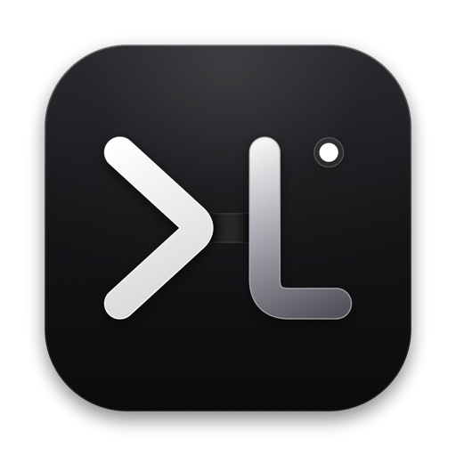
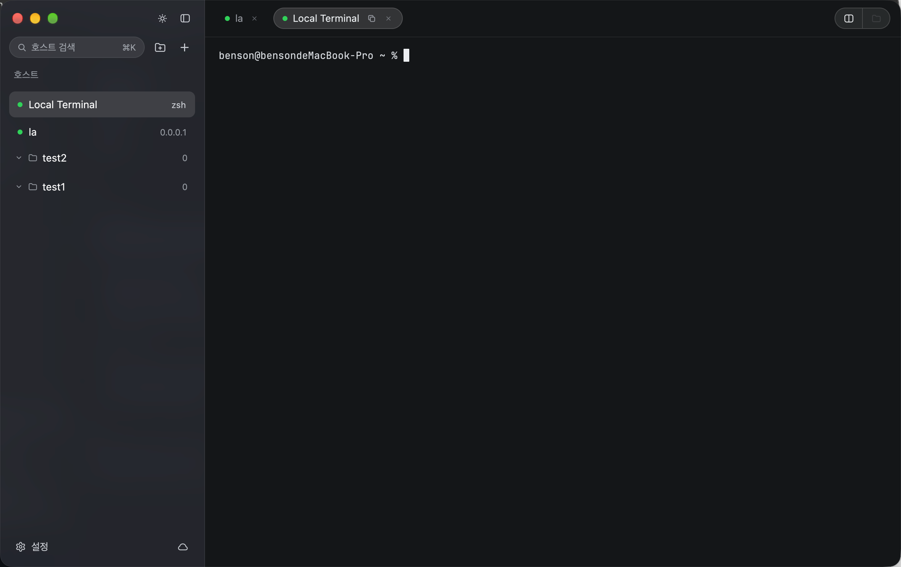
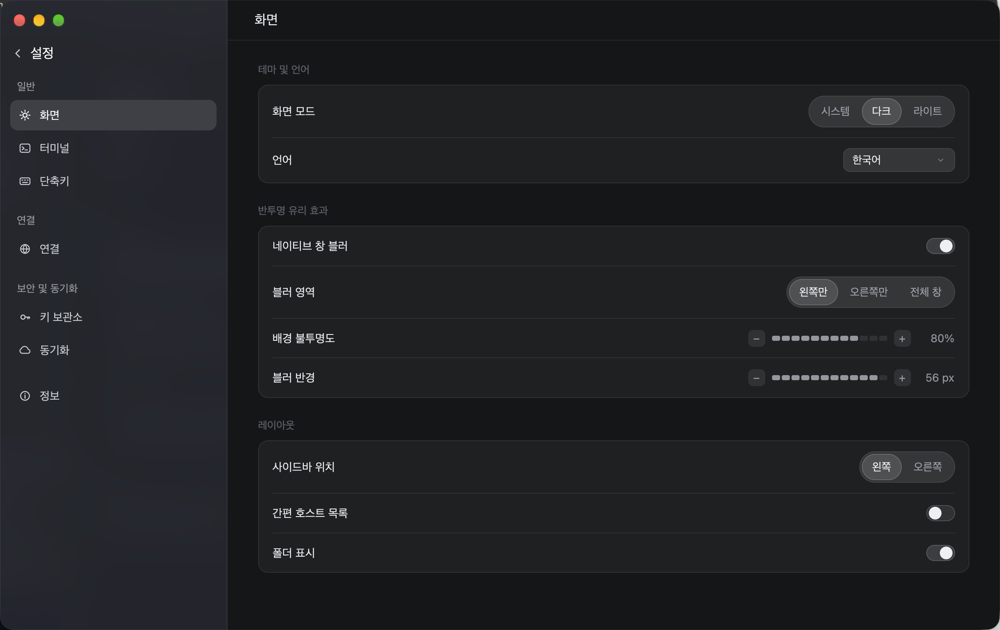
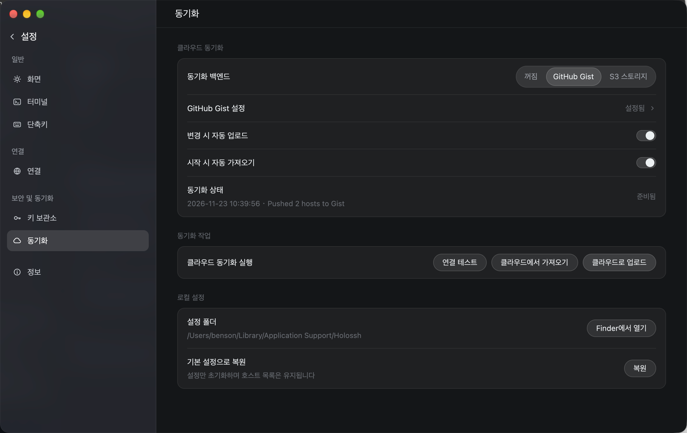

<div align="center">
  <picture>
    <source media="(prefers-color-scheme: dark)" srcset="./assets/app-icon/AppIcon-Dark.png" />
    <source media="(prefers-color-scheme: light)" srcset="./assets/app-icon/AppIcon-Light.png" />
    
  </picture>

  <h1>Holossh</h1>

  <p><strong>아름답고 크로스 플랫폼 동기화를 지원하는 고성능 SSH 클라이언트.</strong></p>

  <p>
    <a href="./README.md">简体中文</a> ·
    <a href="./README.zh-TW.md">繁體中文</a> ·
    <a href="./README.en.md">English</a> ·
    <a href="./README.ja.md">日本語</a> ·
    <strong>한국어</strong>
  </p>

  <p>
    <a href="https://github.com/Fokkyp/Holossh/releases/latest"><strong>최신 버전 다운로드 (macOS)</strong></a>
  </p>
</div>

Holossh는 macOS를 위해 설계되고 GPUI로 구축된 네이티브 SSH 및 로컬 터미널 클라이언트입니다. 절제된 반투명 프로스트 글래스 디자인, 부드러운 GPU 가속 터미널 렌더링, 내장 SFTP 파일 관리, 그리고 종단간 암호화 기반 멀티 디바이스 동기화를 제공합니다.



| 외관 및 프로스트 글래스 | 종단간 클라우드 동기화 |
| :---: | :---: |
|  |  |

---

## 주요 기능

### 네이티브 프로스트 글래스 디자인 & 다국어 지원
- **다크 / 라이트 / 시스템 연동**: 기본 다크 모드를 제공하며 라이트 모드 및 시스템 화면 모드 자동 전환에 맞춰 창 재질과 앱 아이콘이 함께 변경됩니다.
- **맞춤형 글래스 질감**: 블러 적용 범위(사이드바 전용 또는 전체 창), 터미널 불투명도, 블러 강도를 자유롭게 조절할 수 있으며 사이드바 좌우 배치 및 너비 조절을 지원합니다.
- **다국어 인터페이스**: 간체 중국어, 번체 중국어, English, 일본어, 한국어를 내장하며 기본값으로 시스템 언어를 따릅니다.

### 고성능 터미널 & 멀티 페인 워크스페이스
- **대용량 출력에도 부드러운 렌더링**: 대량의 로그 출력에서도 쾌적한 스크롤과 입력 반응을 유지하며 글꼴 크기 조절, 스크롤백 기록 설정, 주요 코딩 글꼴 원클릭 다운로드를 지원합니다.
- **멀티 탭 & 자유로운 화면 분할**: 탭 관리와 좌우·상하 분할을 자유롭게 구성할 수 있으며, 비활성 탭에서 터미널 벨이 울리면 은은한 표시점으로 알려줍니다.
- **세심한 사용성**:
  - 터미널 내 실시간 검색 및 하이라이트;
  - `⌘ + 클릭`으로 터미널 출력 속 링크 바로 열기;
  - 원격 터미널에 파일을 드래그하면 현재 디렉터리로 자동 업로드(`⌥` 키를 누르거나 로컬 터미널에 드래그하면 이스케이프된 경로 붙여넣기);
  - 여러 줄 명령 붙여넣기 시 오실행 방지 확인;
  - 네트워크 끊김 또는 잠자기 해제 후 자동 재연결.

### 다양한 연결 방식 & 로컬 터미널
- **로컬 터미널**: 호스트 추가 시 **로컬 터미널**을 선택하면 별도 주소나 인증 정보 입력 없이 바로 저장하고 기본 로컬 셸을 즉시 실행합니다(macOS 원격 로그인 설정 불필요).
- **유연한 네트워크 접속**: 직접 연결, 다중 점프 호스트(저장된 호스트 재사용), SOCKS5 프록시, HTTP 프록시 지원.
- **완전한 인증 방식**: 자동, 비밀번호, 개인 키(암호 문구 포함), SSH Agent, 키보드 대화형(2FA / OTP) 인증과 최초 연결·호스트 키 변경 시 지문 확인을 제공합니다.
- **`~/.ssh/config` 읽기 전용 가져오기**: 원본 파일을 수정하지 않고 기존 SSH 설정을 간편하게 불러옵니다.

### 내장 SFTP 파일 패널
- 활성 SSH 세션 옆으로 SFTP 패널을 부드럽게 열어 원격 디렉터리 탐색, 폴더 생성, 삭제, 업로드 및 다운로드를 실시간 전송 진행률과 함께 처리할 수 있습니다.

### 종단간 암호화 키 저장소 & 클라우드 동기화
- **로컬 암호화 키 저장소**: 모든 비밀번호와 개인 키는 마스터 비밀번호로 강력하게 암호화되어 저장되며 평문으로 기록되지 않습니다. 잠금 해제 유지 기간(매번 확인, 종료 시까지, 1일 / 3일 / 7일 등)도 설정할 수 있습니다.
- **영지식 클라우드 동기화**: 본인의 **GitHub Gist** 또는 **S3 호환 스토리지**(AWS S3, Cloudflare R2, MinIO 등)를 통해 호스트 목록, 그룹, 설정, 키 저장소를 기기 간 안전하게 동기화합니다. 모든 데이터는 업로드 전 로컬에서 암호화됩니다.
- **로컬 백업**: 설정 파일 수동 내보내기 및 가져오기 지원.

### 자유로운 단축키 사용자 지정
- **설정 → 단축키**에서 원하는 항목을 클릭해 새 키 조합을 바로 입력할 수 있으며, 충돌 자동 감지, 앱 화면 및 macOS 메뉴 막대 실시간 동기화, 기본값 복원을 지원합니다.

---

## 기본 단축키

> 모든 단축키는 **설정 → 단축키**에서 자유롭게 변경할 수 있습니다.

| 기능 | 기본 단축키 |
| --- | --- |
| 호스트 검색 | `⌘K` |
| 설정 열기 / 닫기 | `⌘,` |
| 새 호스트 | `⌘N` |
| 새 탭 | `⌘T` |
| 현재 창 / 탭 닫기 | `⌘W` |
| 터미널에서 찾기 | `⌘F` |
| 좌우 분할 | `⌘D` |
| 상하 분할 | `⇧⌘D` |
| SFTP 파일 패널 열기 / 닫기 | `⌘E` |
| 사이드바 열기 / 닫기 | `⌘B` |
| 글꼴 확대 / 축소 / 초기화 | `⌘+` / `⌘-` / `⌘0` |
| 복사 / 붙여넣기 | `⌘C` / `⌘V` |

---

## 다운로드

[GitHub Releases 최신 버전](https://github.com/Fokkyp/Holossh/releases/latest)에서 Mac용 `.dmg` 설치 파일을 다운로드하세요 (Apple Developer ID 서명 및 공증 완료, macOS 13.0 이상 지원):

- **Apple Silicon**: `Holossh-*-macos-arm64.dmg`
- **Intel Mac**: `Holossh-*-macos-x86_64.dmg`

---

## 소스에서 빌드 및 실행

### 요구 사항
- **운영체제**: macOS
- **도구 체인**: Rust 1.85 이상 ([rustup.rs](https://rustup.rs/)에서 설치)

### 실행 방법

```bash
# 저장소 복제
git clone https://github.com/Fokkyp/Holossh.git
cd holossh

# 릴리스 빌드 및 실행
cargo run --release
```

---

## 개인정보 보호 및 보안

- **평문 자격 증명 저장 금지**: 비밀번호와 키 암호 문구는 로컬 암호화 키 저장소에만 보관됩니다.
- **읽기 전용 SSH 설정 가져오기**: `~/.ssh/config` 가져오기는 엄격히 읽기 전용으로 동작하며 원본 파일을 변경하지 않습니다.
- **종단간 암호화 동기화**: 동기화 데이터는 업로드 전에 로컬에서 암호화되어 별도의 중계 서버 없이 사용자의 GitHub Gist 또는 S3 버킷에 직접 저장됩니다.

---

## 라이선스

이 프로젝트는 [GNU General Public License v3.0 (GPL-3.0)](./LICENSE) 라이선스로 배포됩니다.
