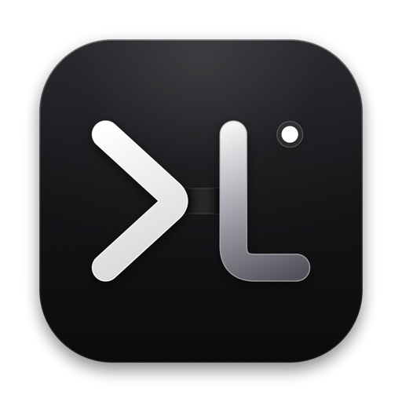
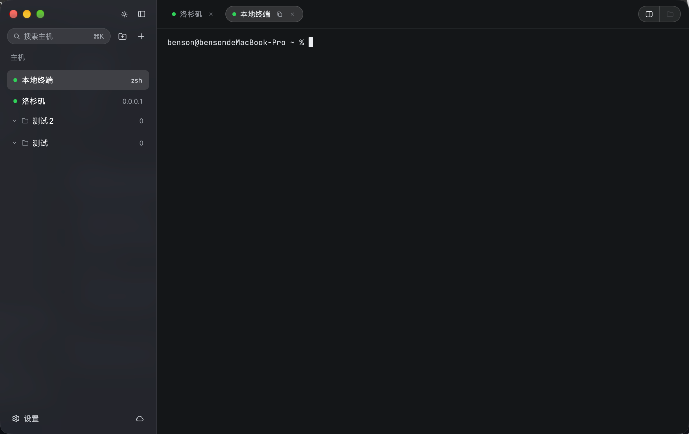
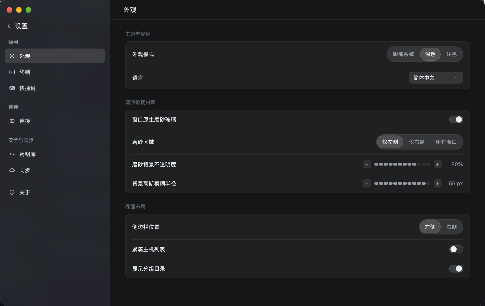
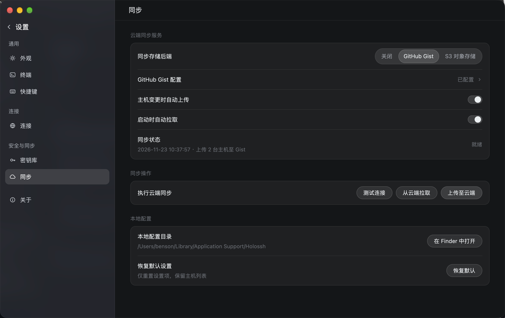

<div align="center">
  <picture>
    <source media="(prefers-color-scheme: dark)" srcset="./assets/app-icon/AppIcon-Dark.png" />
    <source media="(prefers-color-scheme: light)" srcset="./assets/app-icon/AppIcon-Light.png" />
    
  </picture>

  <h1>Holossh</h1>

  <p><strong>优美的、支持跨平台同步的高性能 SSH 客户端。</strong></p>

  <p>
    <strong>简体中文</strong> ·
    <a href="./README.zh-TW.md">繁體中文</a> ·
    <a href="./README.en.md">English</a> ·
    <a href="./README.ja.md">日本語</a> ·
    <a href="./README.ko.md">한국어</a>
  </p>

  <p>
    <a href="https://github.com/Fokkyp/Holossh/releases/latest"><strong>下载最新版本（macOS）</strong></a>
  </p>
</div>

Holossh 是一款为 macOS 打造的原生 SSH 与本地终端客户端，采用GPUI构建，融合通透克制的毛玻璃磨砂视觉、流畅的 GPU 加速终端渲染、内置 SFTP 文件管理，以及端到端加密的多设备云同步能力。



| 外观与磨砂玻璃材质 | 端到端云同步 |
| :---: | :---: |
|  |  |

---

## 核心特性

### 原生磨砂美学与多语言
- **深浅双模式**：默认深色模式，支持浅色模式与跟随系统自动切换，应用图标与窗口材质同步适配。
- **可调磨砂质感**：自由控制磨砂作用范围（仅侧边栏或全窗通透）、终端不透明度与高斯模糊强度，侧边栏支持左右切换与宽度拖拽。
- **多语言界面**：内置简体中文、繁體中文、English、日本語、한국어，默认跟随系统语言并可随时切换。

### 高性能终端与多窗格工作区
- **极速渲染与高吞吐**：针对大流量日志输出优化，滚动与输入保持跟手流畅，支持字体字号缩放、历史回滚与多款编程字体一键下载。
- **多标签与自由分屏**：支持标签页管理与任意左右/上下分屏，独立会话互不干扰；非活跃标签收到终端响铃提醒时自动以极简指示点提示。
- **贴心交互细节**：
  - 支持终端内关键词实时高亮查找；
  - `⌘ + 点击` 直接打开终端中的链接；
  - 将本地文件拖入远端终端自动上传至当前目录（按住 `⌥` 拖入或拖入本地终端则自动转义并粘贴路径）；
  - 粘贴多行命令时自动弹出安全确认，避免误执行；
  - 网络抖动或休眠唤醒后支持自动重连。

### 丰富的连接方式与本地终端
- **本地终端**：在新建主机中选择「本地终端」即可直接保存并启动本机默认 Shell，无需填写地址或开启系统远程登录。
- **灵活的网络接入**：支持直连、多级跳板机（直接复用已保存主机）、SOCKS5 代理与 HTTP 代理。
- **完整身份验证**：支持自动认证、密码、私钥（支持带口令私钥）、SSH Agent 及键盘交互（支持 2FA / OTP 二次验证），并在首次连接或主机指纹变化时提供安全确认。
- **一键导入 `~/.ssh/config`**：快速导入现有 SSH 配置，仅做只读解析，绝不修改用户原有文件。

### 内置 SFTP 文件面板
- 无需额外打开第三方工具，点击右上角文件图标即可在当前 SSH 会话旁平滑展开 SFTP 抽屉。
- 支持目录浏览、新建文件夹、删除、上传与下载，并在底部实时展示传输进度与取消控制。

### 端到端加密密钥库与云同步
- **本地加密密钥库**：所有主机密码与私钥均经主密码高强度加密存储，绝不明文写入配置文件；可按需设置解锁记忆周期（每次验证、保持至退出、记住 1 天 / 3 天 / 7 天等）。
- **多设备端到端加密同步**：支持通过 **GitHub Gist** 或任意 **S3 兼容对象存储**（如 AWS S3、Cloudflare R2、MinIO 等）同步主机列表、分组、设置与密钥库；数据在上传前即完成本地加密，服务端无法读取任何明文内容。
- **本地备份**：支持手动导入与导出配置文件。

### 全面自定义快捷键
- 可在 **设置 → 快捷键** 中点击任意快捷键直接按键录入，自动检测冲突，实时同步至应用界面与 macOS 顶部菜单栏，并支持一键恢复默认。

---

## 默认快捷键

> 所有快捷键均可在 **设置 → 快捷键** 中自由修改。

| 功能 | 默认快捷键 |
| --- | --- |
| 搜索主机 | `⌘K` |
| 打开 / 关闭设置 | `⌘,` |
| 新建主机 | `⌘N` |
| 新建标签页 | `⌘T` |
| 关闭当前窗格 / 标签页 | `⌘W` |
| 在终端中查找 | `⌘F` |
| 左右分屏 | `⌘D` |
| 上下分屏 | `⇧⌘D` |
| 展开 / 收起 SFTP 文件面板 | `⌘E` |
| 展开 / 收起侧边栏 | `⌘B` |
| 增大 / 减小 / 重置字体大小 | `⌘+` / `⌘-` / `⌘0` |
| 复制 / 粘贴 | `⌘C` / `⌘V` |

---

## 下载安装

前往 [GitHub Releases 最新版本](https://github.com/Fokkyp/Holossh/releases/latest) 下载适用于你的 Mac 的 `.dmg` 安装包（已通过 Apple Developer ID 签名与苹果官方公证，支持 macOS 13.0 及以上）：

- **Apple Silicon**：`Holossh-*-macos-arm64.dmg`
- **Intel Mac**：`Holossh-*-macos-x86_64.dmg`

---

## 从源码构建与运行

### 环境要求
- **操作系统**：macOS
- **工具链**：Rust 1.85 及以上版本（可通过 [rustup.rs](https://rustup.rs/) 安装）

### 运行方式

```bash
# 克隆仓库
git clone https://github.com/Fokkyp/Holossh.git
cd holossh

# 编译并运行发布版本
cargo run --release
```

---

## 隐私与安全说明

- **绝不明文存储凭据**：密码与私钥口令仅保存在本地加密密钥库中，不会明文出现在普通配置文件里。
- **只读解析本地配置**：导入 `~/.ssh/config` 时严格保持只读，不会改动或覆盖原文件。
- **端到端云同步**：启用云同步后，主机信息与密钥均先在本地加密再上传至你自己的 GitHub Gist 或 S3 存储桶，Holossh 不经过任何第三方中转服务器。

---

## 开源协议

本项目基于 [GNU General Public License v3.0 (GPL-3.0)](./LICENSE) 开源。
