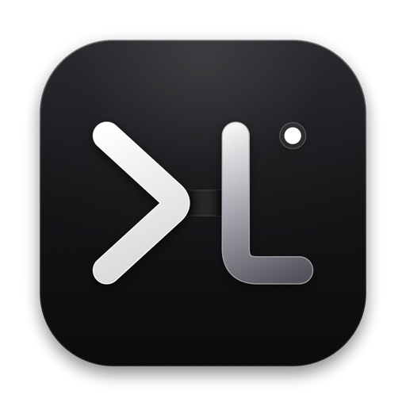
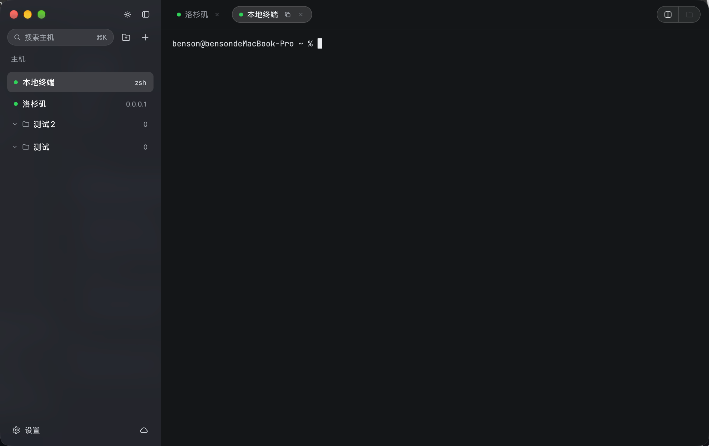
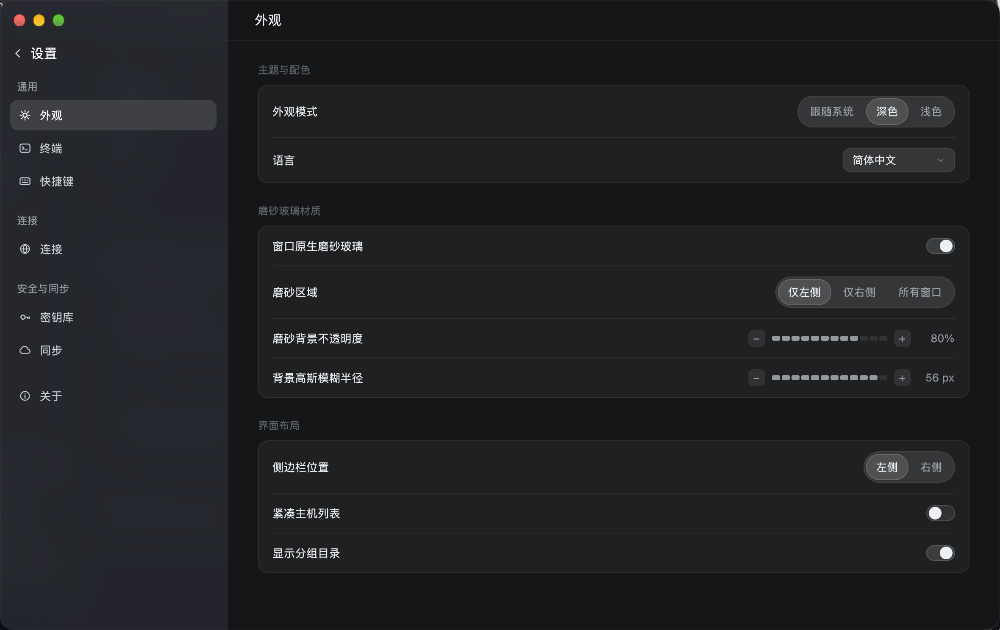
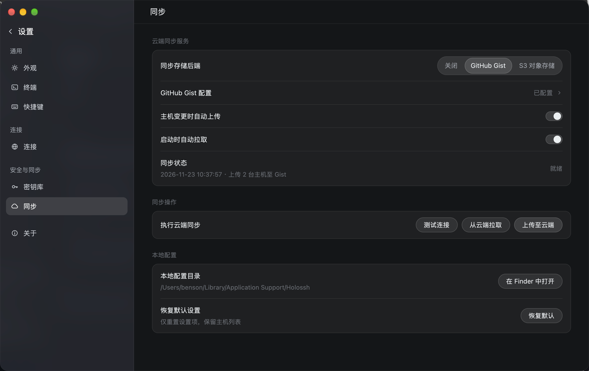

<div align="center">
  <picture>
    <source media="(prefers-color-scheme: dark)" srcset="./assets/app-icon/AppIcon-Dark.png" />
    <source media="(prefers-color-scheme: light)" srcset="./assets/app-icon/AppIcon-Light.png" />
    
  </picture>

  <h1>Holossh</h1>

  <p><strong>優美的、支援跨平台同步的高效能 SSH 用戶端。</strong></p>

  <p>
    <a href="./README.md">简体中文</a> ·
    <strong>繁體中文</strong> ·
    <a href="./README.en.md">English</a> ·
    <a href="./README.ja.md">日本語</a> ·
    <a href="./README.ko.md">한국어</a>
  </p>
</div>

Holossh 是一款專為 macOS 打造的原生 SSH 與本機終端機用戶端，採用 GPUI 建構，結合通透克制的毛玻璃磨砂視覺、流暢的 GPU 加速終端機算繪、內建 SFTP 檔案管理，以及端對端加密的多裝置雲端同步能力。



| 外觀與磨砂玻璃材質 | 端對端雲端同步 |
| :---: | :---: |
|  |  |

---

## 核心特色

### 原生磨砂美學與多語言
- **深淺雙模式**：預設深色模式，支援淺色模式與跟隨系統自動切換，應用程式圖示與視窗材質同步適配。
- **可調磨砂質感**：自由控制磨砂作用範圍（僅側邊欄或全視窗通透）、終端機不透明度與高斯模糊強度，側邊欄支援左右切換與寬度拖曳。
- **多語言介面**：內建简体中文、繁體中文、English、日本語、한국어，預設跟隨系統語言並可隨時切換。

### 高效能終端機與多窗格工作區
- **極速算繪與高吞吐**：針對大流量日誌輸出最佳化，捲動與輸入保持跟手流暢，支援字型字級縮放、歷史回捲與多款程式設計字型一鍵下載。
- **多分頁與自由分割畫面**：支援分頁管理與任意左右／上下分割畫面，獨立工作階段互不干擾；非使用中分頁收到終端機響鈴提醒時自動以極簡指示點提示。
- **貼心互動細節**：
  - 支援終端機內關鍵字即時高光搜尋；
  - `⌘ + 點擊` 直接開啟終端機中的連結；
  - 將本機檔案拖入遠端終端機自動上傳至目前目錄（按住 `⌥` 拖入或拖入本機終端機則自動跳脫並貼上路徑）；
  - 貼上多行指令時自動彈出安全確認，避免誤執行；
  - 網路波動或休眠喚醒後支援自動重新連線。

### 豐富的連線方式與本機終端機
- **本機終端機**：在新增主機中選擇「本機終端機」即可直接儲存並啟動本機預設 Shell，無需填寫位址或開啟系統遠端登入。
- **靈活的網路接入**：支援直連、多級跳板機（直接沿用已儲存主機）、SOCKS5 代理與 HTTP 代理。
- **完整身分驗證**：支援自動驗證、密碼、私鑰（支援帶通行密碼私鑰）、SSH Agent 及鍵盤互動（支援 2FA / OTP 二次驗證），並在首次連線或主機指紋變更時提供安全確認。
- **一鍵匯入 `~/.ssh/config`**：快速匯入現有 SSH 設定，僅作唯讀解析，絕不修改使用者原有檔案。

### 內建 SFTP 檔案面板
- 無需額外開啟第三方工具，點擊右上角檔案圖示即可在目前 SSH 工作階段旁平滑展開 SFTP 抽屜。
- 支援目錄瀏覽、新增資料夾、刪除、上傳與下載，並在底部即時顯示傳輸進度與取消控制。

### 端對端加密金鑰庫與雲端同步
- **本機加密金鑰庫**：所有主機密碼與私鑰皆經主密碼高強度加密儲存，絕不明文寫入設定檔；可依需求設定解鎖記憶週期（每次驗證、保持至結束、記住 1 天 / 3 天 / 7 天等）。
- **多裝置端對端加密同步**：支援透過 **GitHub Gist** 或任意 **S3 相容物件儲存**（如 AWS S3、Cloudflare R2、MinIO 等）同步主機清單、分組、設定與金鑰庫；資料在上傳前即完成本機加密，伺服器端無法讀取任何明文內容。
- **本機備份**：支援手動匯入與匯出設定檔。

### 全面自訂快速鍵
- 可在 **設定 → 快速鍵** 中點擊任意快速鍵直接按鍵錄製，自動偵測衝突，即時同步至應用程式介面與 macOS 頂部選單列，並支援一鍵恢復預設。

---

## 預設快速鍵

> 所有快速鍵皆可在 **設定 → 快速鍵** 中自由修改。

| 功能 | 預設快速鍵 |
| --- | --- |
| 搜尋主機 | `⌘K` |
| 開啟 / 關閉設定 | `⌘,` |
| 新增主機 | `⌘N` |
| 新增分頁 | `⌘T` |
| 關閉目前窗格 / 分頁 | `⌘W` |
| 在終端機中尋找 | `⌘F` |
| 左右分割畫面 | `⌘D` |
| 上下分割畫面 | `⇧⌘D` |
| 展開 / 收起 SFTP 檔案面板 | `⌘E` |
| 展開 / 收起側邊欄 | `⌘B` |
| 放大 / 縮小 / 重設字型大小 | `⌘+` / `⌘-` / `⌘0` |
| 複製 / 貼上 | `⌘C` / `⌘V` |

---

## 從原始碼建置與執行

### 環境需求
- **作業系統**：macOS
- **工具鏈**：Rust 1.85 及以上版本（可透過 [rustup.rs](https://rustup.rs/) 安裝）

### 執行方式

```bash
# 複製儲存庫
git clone https://github.com/Fokkyp/Holossh.git
cd holossh

# 編譯並執行正式版本
cargo run --release
```

---

## 隱私與安全說明

- **絕不明文儲存憑證**：密碼與私鑰口令僅儲存在本機加密金鑰庫中，不會明文出現在一般設定檔裡。
- **唯讀解析本機設定**：匯入 `~/.ssh/config` 時嚴格保持唯讀，不會改動或覆蓋原檔案。
- **端對端雲端同步**：啟用雲端同步後，主機資訊與金鑰皆先在本機加密再上傳至你自己的 GitHub Gist 或 S3 儲存貯體，Holossh 不經過任何第三方中繼伺服器。

---

## 開源授權

本專案基於 [GNU General Public License v3.0 (GPL-3.0)](./LICENSE) 開源。
